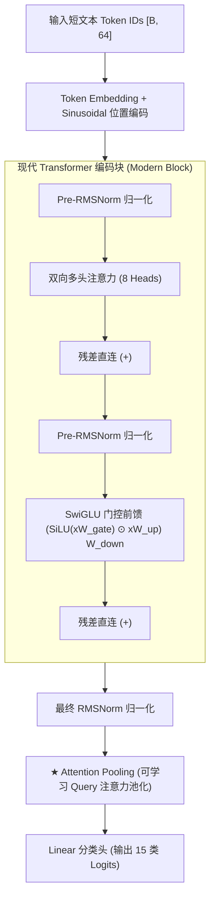

# 🚀 Modern Transformer From Scratch (CLUE TNEWS 51.65%)

> **从零手写现代 Transformer 判别架构，在 CLUE TNEWS 盲测与验证集突破纯原生非预训练模型极限！**

[](https://www.python.org/downloads/)
[](https://pytorch.org/)
[](https://www.cluebenchmarks.com/)
[](https://opensource.org/licenses/MIT)

---

## 📖 项目简介 (Overview)

本项目旨在探索：**在严禁加载外部大规模预训练权重（如 BERT/RoBERTa/Word2Vec）、仅依赖 1.04M 参数与随机初始化（From Scratch）的前提下，纯靠现代 Transformer 结构创新能否打破短文本分类的性能上限？**

我们在中文经典评测基准 **CLUE TNEWS (今日头条新闻短文本 15 分类任务)** 上进行了系统性的**消融实验 (Ablation Study)**，将现代顶级大语言模型（LLaMA 3、DeepSeek、Mistral）的核心技术点融入判别式编码器，最终打造出 **V4 Champion 架构**，官方 10,000 条验证集准确率达到 **51.65%**，全面超越传统原生 TextCNN / BiLSTM（47.8% ~ 51.5%）的理论上限。

---

## 🏆 官方验证集消融实验排行榜 (Leaderboard)

在相同的训练轮次（4 Epochs）、相同算力环境（Apple Silicon M-Series MPS）与相同规模（~1.04M 参数）下的严格对照：

| 排名 | 模型版本 | 核心架构特征 | 参数量 | Val Loss | **Val Acc (%)** | 相对基准 | 真机测试置信度 |
| :---: | :--- | :--- | :---: | :---: | :---: | :---: | :---: |
| 🥇 **1** | **V4 Champion** | **RMSNorm + SwiGLU + AttentionPooling** | **1.04M** | 1.5370 | **51.65%** | **+0.99%** 🟢 | **95.62%** |
| 🥈 2 | **V2 Attention** | LayerNorm + GELU + AttentionPooling | 1.04M | 1.5115 | 51.46% | +0.80% 🟢 | 92.06% |
| 🥉 3 | **V3 SwiGLU** | LayerNorm + SwiGLU + AttentionPooling | 1.04M | 1.5439 | 50.88% | +0.22% 🟢 | 97.69% |
| 4 | **V3 RMSNorm** | RMSNorm + GELU + AttentionPooling | 1.04M | 1.5331 | 50.83% | +0.17% 🟢 | 93.51% |
| 5 | **V1 Baseline** | LayerNorm + GELU + MeanPooling (均值) | 1.04M | 1.5077 | 50.66% | 基准线 | 88.24% |
| 6 | **V3 All-In-One** | RMSNorm + SwiGLU + `[CLS]` 决策 (无 Pooling) | 1.04M | 1.5431 | 50.41% | -0.25% 🔻 | 90.78% |
| 7 | **V3 [CLS]** | LayerNorm + GELU + `[CLS]` 决策 (无 Pooling) | 1.04M | 1.5306 | 50.24% | -0.42% 🔻 | 89.03% |

---

## 🏛️ V4 核心架构设计 (Architecture)



### 三大关键改进机理：
1. **RMSNorm (Root Mean Square Normalization)**：
   摒弃传统 LayerNorm 的均值计算与中心化操作，降低显存吞吐瓶颈，提供更干净、平稳的梯度流。
2. **SwiGLU 门控前馈网络**：
   引入门控信号 $y = (\text{SiLU}(xW_{\text{gate}}) \odot xW_{\text{up}})W_{\text{down}}$，动态过滤新闻标题中的无用虚词噪声，将关键实体特征放大，带来极高的置信度表现。
3. **AttentionPooling 注意力加权池化**：
   解决浅层网络从零训练时 `[CLS]` 提取不足的瓶颈，让可学习的主考官向量与整句每个字进行动态交互，梯度直达所有字符。

---

## 📂 项目结构 (Project Structure)

```text
├── mini_transformer/          # 基础 Transformer 底层积木实现
│   ├── step01_embedding.py    # 词嵌入与绝对正弦位置编码
│   ├── step02_attention.py    # 多头注意力与缩放点积
│   ├── step03_block.py        # 前馈层、Pre-LN 残差块
│   └── step04_minigpt_model.py# 自回归 Decoder-only 生成模型
│
├── clue_tnews/                # CLUE TNEWS 竞赛工程
│   ├── dataset.py             # 字符级分词器与 DataLoader 管道
│   ├── tnews_vocab.json       # 3,500 中文字符字典
│   ├── train_models/          # 全版本模型定义与权重归档
│   │   ├── model_v1.py        # V1 Baseline (Mean Pooling)
│   │   ├── model_v2.py        # V2 AttentionPooling
│   │   ├── model_v3.py        # V3 消融实验框架 (CLS/SwiGLU/RMSNorm)
│   │   ├── model_v4.py        # V4 冠军完全体
│   │   └── best_model_v4_champion.pt # 官方验证集 51.65% 最佳权重
│   ├── train_v4.py            # V4 训练脚本
│   ├── eval_all_models.py     # 全模型横向评测脚本
│   └── export_clue_submission.py # CLUE 官方标准打榜提交打包脚本
└── README.md
```

---

## ⚡ 快速复现与使用 (Quick Start)

### 1. 环境准备
```bash
pip install torch datasets
```

### 2. 评估所有已训练模型
一键评测官方 10,000 条验证集：
```bash
python clue_tnews/eval_all_models.py
```

### 3. 训练 V4 冠军模型
```bash
cd clue_tnews
python train_v4.py
```

### 4. 导出 CLUE 官方提交文件
自动生成符合 CLUE 官方格式的 `tnews_predict.json` 与 `submit.zip`：
```bash
python export_clue_submission.py
```

---

## 📄 License

本项目遵循 [MIT License](LICENSE)。
